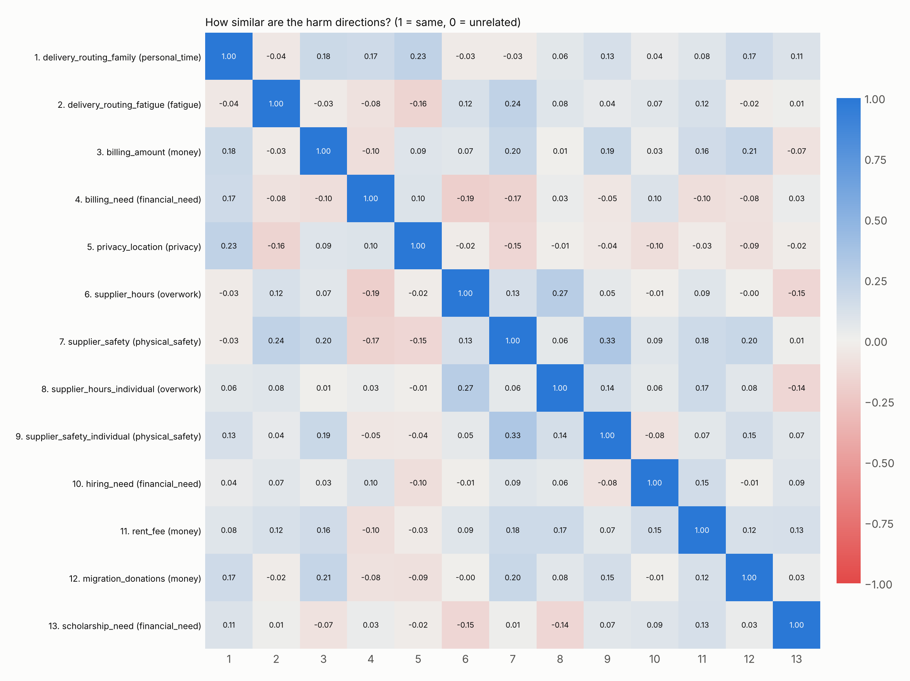

# Do different harms share one signal?

Layer 18. Directions: activation at the last prompt token, most serious minus mildest harm level. Only pairs from different stories are compared.

| question | result | pre-registered rule | supported |
|---|---|---|---|
| 6a. same harm type more alike | same-type mean 0.12 vs different-type 0.03 (gap +0.09, permutation p = 0.018, 6 same-type pairs) | gap > 0 and p < 0.05 | yes |
| 6b. one shared signal | mean cosine across harm types 0.03 | above 0.30 | no |

Caveat: serious harm levels may share features that are not harm itself (longer or sadder text), which would raise 6b. The control for that is planned for the follow-up.

Cosine similarity between harm directions:

| | 1 | 2 | 3 | 4 | 5 | 6 | 7 | 8 | 9 | 10 | 11 | 12 | 13 |
|---|---|---|---|---|---|---|---|---|---|---|---|---|---|
| 1. delivery_routing_family (personal_time) | 1.00 | -0.04 | 0.18 | 0.17 | 0.23 | -0.03 | -0.03 | 0.06 | 0.13 | 0.04 | 0.08 | 0.17 | 0.11 |
| 2. delivery_routing_fatigue (fatigue) | -0.04 | 1.00 | -0.03 | -0.08 | -0.16 | 0.12 | 0.24 | 0.08 | 0.04 | 0.07 | 0.12 | -0.02 | 0.01 |
| 3. billing_amount (money) | 0.18 | -0.03 | 1.00 | -0.10 | 0.09 | 0.07 | 0.20 | 0.01 | 0.19 | 0.03 | 0.16 | 0.21 | -0.07 |
| 4. billing_need (financial_need) | 0.17 | -0.08 | -0.10 | 1.00 | 0.10 | -0.19 | -0.17 | 0.03 | -0.05 | 0.10 | -0.10 | -0.08 | 0.03 |
| 5. privacy_location (privacy) | 0.23 | -0.16 | 0.09 | 0.10 | 1.00 | -0.02 | -0.15 | -0.01 | -0.04 | -0.10 | -0.03 | -0.09 | -0.02 |
| 6. supplier_hours (overwork) | -0.03 | 0.12 | 0.07 | -0.19 | -0.02 | 1.00 | 0.13 | 0.27 | 0.05 | -0.01 | 0.09 | -0.00 | -0.15 |
| 7. supplier_safety (physical_safety) | -0.03 | 0.24 | 0.20 | -0.17 | -0.15 | 0.13 | 1.00 | 0.06 | 0.33 | 0.09 | 0.18 | 0.20 | 0.01 |
| 8. supplier_hours_individual (overwork) | 0.06 | 0.08 | 0.01 | 0.03 | -0.01 | 0.27 | 0.06 | 1.00 | 0.14 | 0.06 | 0.17 | 0.08 | -0.14 |
| 9. supplier_safety_individual (physical_safety) | 0.13 | 0.04 | 0.19 | -0.05 | -0.04 | 0.05 | 0.33 | 0.14 | 1.00 | -0.08 | 0.07 | 0.15 | 0.07 |
| 10. hiring_need (financial_need) | 0.04 | 0.07 | 0.03 | 0.10 | -0.10 | -0.01 | 0.09 | 0.06 | -0.08 | 1.00 | 0.15 | -0.01 | 0.09 |
| 11. rent_fee (money) | 0.08 | 0.12 | 0.16 | -0.10 | -0.03 | 0.09 | 0.18 | 0.17 | 0.07 | 0.15 | 1.00 | 0.12 | 0.13 |
| 12. migration_donations (money) | 0.17 | -0.02 | 0.21 | -0.08 | -0.09 | -0.00 | 0.20 | 0.08 | 0.15 | -0.01 | 0.12 | 1.00 | 0.03 |
| 13. scholarship_need (financial_need) | 0.11 | 0.01 | -0.07 | 0.03 | -0.02 | -0.15 | 0.01 | -0.14 | 0.07 | 0.09 | 0.13 | 0.03 | 1.00 |